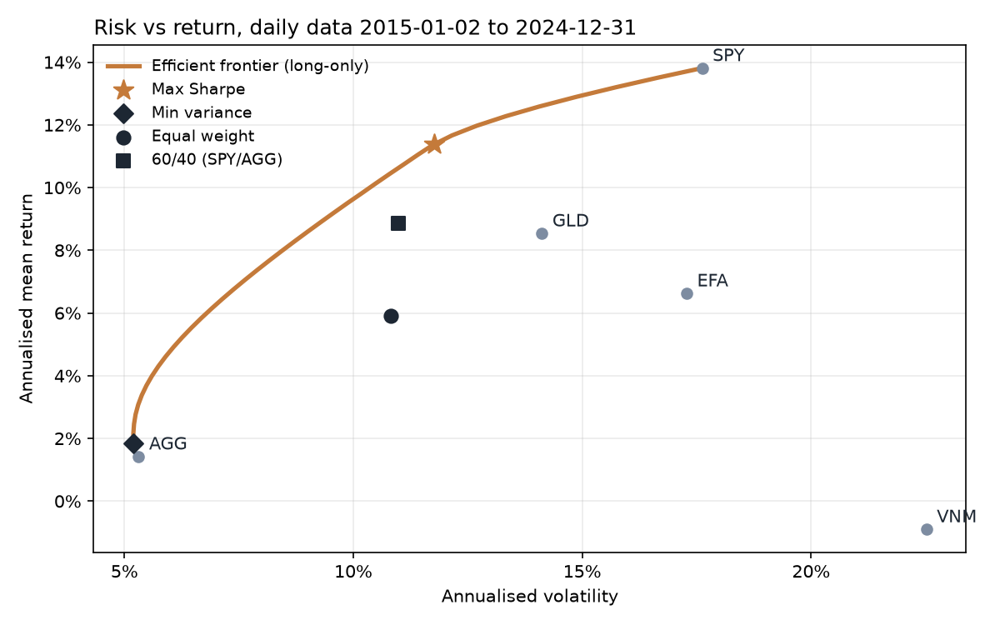
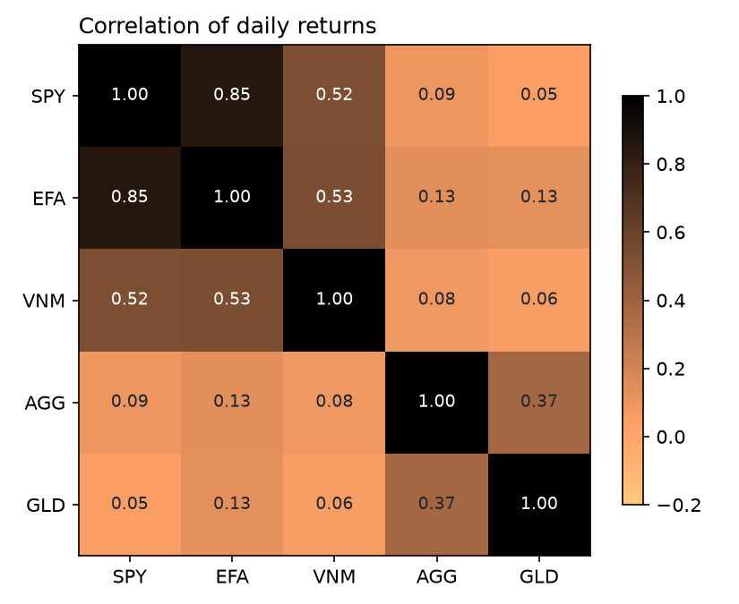

# Portfolio analysis and efficient frontier (Python)

**Question.** How should a long-only investor split money across US, international and Vietnamese equities, bonds and gold? And does the "optimal" mix still hold up on data it has not seen?

## Data
- Daily adjusted close prices (dividends reinvested) from Yahoo Finance via `yfinance`, **2 Jan 2015 – 31 Dec 2024** (2,515 trading days). They are cached in `data/prices.csv`, so the results can be reproduced exactly.

| Ticker | Asset |
|---|---|
| SPY | US equities (S&P 500) |
| EFA | Developed ex-US equities |
| VNM | Vietnam equities |
| AGG | US investment-grade bonds |
| GLD | Gold |
| BIL | 1–3 month US T-bills, used as the risk-free rate (1.60% a year) |

## Method
1. Daily simple returns, annualised with 252 trading days: mean return, volatility, correlation matrix, CAGR, maximum drawdown.
2. Long-only optimisation with SciPy (SLSQP, weights ≥ 0 that sum to 100%): **maximum Sharpe ratio**, **minimum variance**, and the **efficient frontier** (minimum variance for each target return).
3. Benchmarks: **equal weight** and a classic **60/40** (SPY/AGG).
4. **Out-of-sample test:** fit the maximum-Sharpe weights on 2015–2019 only, then hold them through 2020–2024.

## Results

### Single assets, 2015–2024
| | Mean return | Volatility | CAGR | Sharpe | Max drawdown |
|---|---|---|---|---|---|
| SPY | 13.8% | 17.6% | 13.0% | 0.69 | −33.7% |
| EFA | 6.6% | 17.3% | 5.2% | 0.29 | −34.2% |
| VNM | −0.9% | 22.5% | −3.4% | −0.11 | −51.7% |
| AGG | 1.4% | 5.3% | 1.3% | −0.03 | −18.4% |
| GLD | 8.5% | 14.1% | 7.8% | 0.49 | −22.0% |

### Portfolios, in sample (2015–2024)
| Portfolio | Weights | Return | Volatility | Sharpe | Max drawdown |
|---|---|---|---|---|---|
| **Max Sharpe** | SPY 54%, GLD 46% | 11.4% | 11.8% | **0.83** | −21.2% |
| Min variance | AGG 94%, rest ≤ 3% each | 1.9% | 5.2% | 0.05 | −18.2% |
| Equal weight | 20% each | 5.9% | 10.8% | 0.40 | −24.4% |
| 60/40 | SPY 60%, AGG 40% | 8.9% | 11.0% | 0.66 | −21.7% |



### Out of sample (weights fitted on 2015–2019, held 2020–2024)
| Portfolio | Weights | Return | Volatility | Sharpe | Max drawdown |
|---|---|---|---|---|---|
| Max Sharpe (fitted 2015–2019) | SPY 22%, AGG 75%, GLD 4% | 3.8% | 7.7% | **0.19** | −17.5% |
| Equal weight | 20% each | 6.4% | 12.7% | 0.32 | −24.4% |
| 60/40 | SPY 60%, AGG 40% | 9.4% | 13.4% | **0.53** | −21.7% |



## Findings
1. **Gold was the best diversifier.** Its correlation with US equities was only 0.05, so the in-sample maximum-Sharpe mix paired the S&P 500 with gold (54/46). That mix had a Sharpe ratio of 0.83, against 0.66 for 60/40.
2. **The "optimal" weights did not survive new data.** Fitted on 2015–2019, the optimiser put 75% into bonds. Bonds (AGG) then returned −0.1% a year in 2020–2024, including −13.0% in 2022, and the portfolio's Sharpe ratio fell to 0.19, well below the simple 60/40 (0.53).
3. **Vietnam equities (VNM ETF) added risk without return** over this period: −3.4% a year with a −51.7% drawdown. Their correlation with US equities (0.53) also limited the diversification benefit.

**Takeaway:** mean-variance optimisation is very sensitive to the return estimates. In practice I would use it with weight limits, longer or shrunk return estimates, or regular rebalancing tests rather than trusting one in-sample answer.

## Limitations
- Historical, in-sample statistics; past returns do not predict future returns. This is not investment advice.
- Uses arithmetic mean returns and a normal-risk (volatility) view; ignores transaction costs, taxes and currency effects (all prices are in USD).
- VNM is a US-listed ETF and only a proxy for the Vietnamese market.

## Run it yourself
```bash
python -m venv .venv
.venv\Scripts\python -m pip install -r requirements.txt
.venv\Scripts\python test_analysis.py      # self-checks on synthetic data
.venv\Scripts\python analysis.py           # uses cached prices
.venv\Scripts\python analysis.py --refresh # downloads prices again
```
Change the tickers or the period at the top of `analysis.py`. Outputs go to `results/`: `summary.json`, `efficient_frontier.png` and `correlation.png`.
